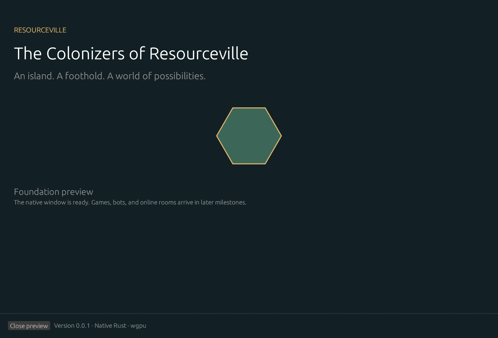

# The Colonizers of Resourceville

Build a foothold on a resource-rich island, trade with your neighbors, and turn a small settlement into a thriving network of towns and trade routes. **The Colonizers of Resourceville** is a native Rust strategy game in development for Windows, with original branding and a focus on readable boards, meaningful choices, and games you can play with friends or bots.

The planned experience starts with gathering resources, negotiating trades, building roads and settlements, and competing for victory points. Later releases expand into seafaring, city development, defense, caravans, exploration, and scenario objectives. Hosts will be able to choose maps, rules, player counts, and human/bot seats before each game.

Offline solo play and private online rooms come first. The roadmap then grows from 2–4 to 2–8 players, followed by public casual play and ranked queues. The desktop client and authoritative game server will both use Rust; online identity and persistence will use Supabase.

**Current status:** Milestone 01 native foundation is in development on milestone-01/foundation. The five-crate Rust workspace includes a native wgpu preview and a liveness-only server. There is no playable game or approved native release yet.

[Documentation wiki](https://github.com/Codings-Biggest-Fan/colonizers-of-resourceville/wiki) · [Game Instructions](https://github.com/Codings-Biggest-Fan/colonizers-of-resourceville/wiki/Game-Instructions) · [Releases](https://github.com/Codings-Biggest-Fan/colonizers-of-resourceville/releases)

## Roadmap

| Milestones | What they deliver | Status |
| --- | --- | --- |
| 0 | Project setup, plans, wiki, and approval workflow | Merged; no release recorded |
| 1 | Native Rust foundation | In progress |
| 2–3 | Rules/configuration contracts and board preview | Planned |
| 4–6 | Complete base rules, bots, and offline save/resume | Planned |
| 7–10 | Online identity, private rooms, reliable multiplayer, and pregame options | Planned |
| 11–14 | Citadels & Sentinels, Open Seas, combined scenarios, and up to eight players | Planned |
| 15–17 | Caravans & Raiders, Voyagers & Corsairs, map tools, and supported combinations | Planned |
| 18–20 | Public casual games, ranked play, and release verification | Planned |

Follow the [current roadmap](ROADMAP.md) for individual releases, acceptance gates, and progress. Each milestone has a plan, reports, and screenshot evidence. Each ships through its own PR and GitHub Release after user testing and approval.

## Screenshots

These are actual native wgpu frames from the M01 foundation preview. Gameplay arrives in later milestones.



[Compact layout](photos/milestone-01/007-native-compact-responsive.png) · [High zoom layout](photos/milestone-01/008-native-zoom-responsive.png) · [Capture metadata and before/after evidence](photos/milestone-01/index.md) · [M00 documentation previews](photos/milestone-00/index.md)

## Building and checking the project

Install the pinned Rust/MSVC prerequisites, then use the current development branch:

```powershell
git clone https://github.com/Codings-Biggest-Fan/colonizers-of-resourceville.git
Set-Location colonizers-of-resourceville
git switch nightly
pwsh -NoProfile -File ./scripts/bootstrap.ps1
pwsh -NoProfile -File ./scripts/check.ps1 -Release
pwsh -NoProfile -File ./scripts/test.ps1
pwsh -NoProfile -File ./scripts/dev.ps1
```

The [Building guide](docs/building.md) covers prerequisites, native launch, server liveness, captures, packaging, and troubleshooting. GitHub builds cover Windows, Linux, and macOS on x86-64 and ARM64; nonlocal builds do not prove interactive runtime behavior.

### Development channels

- **nightly:** latest pushed development work, possibly unfinished.
- **beta:** latest user-approved implementation before polish.
- **stable:** approved implementation and approved polish; default branch.
- **main:** compatibility mirror of polished stable.

See the [contribution and release workflow](docs/github-workflow.md) and [agent instructions](AGENTS.md) before making changes. The project license has not been selected; asset sources are recorded in [attribution](assets/ATTRIBUTION.md).
