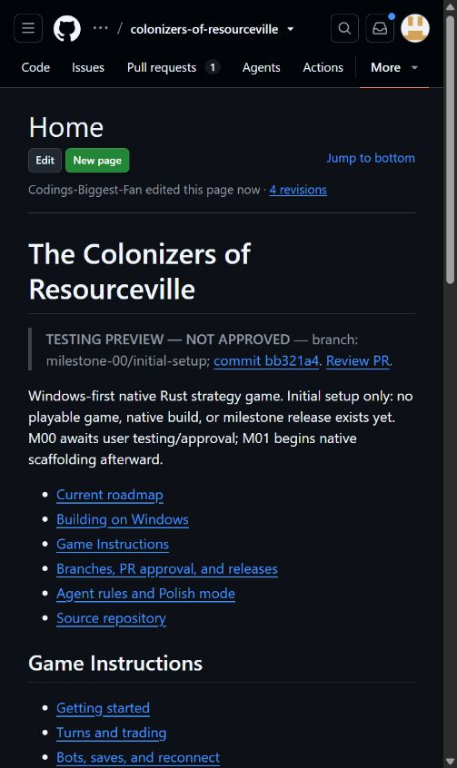

# The Colonizers of Resourceville

Build a foothold on a resource-rich island, trade with your neighbors, and turn a small settlement into a thriving network of towns and trade routes. **The Colonizers of Resourceville** is a native Rust strategy game in development for Windows, with original branding and a focus on readable boards, meaningful choices, and games you can play with friends or bots.

The planned experience starts with gathering resources, negotiating trades, building roads and settlements, and competing for victory points. Later releases expand into seafaring, city development, defense, caravans, exploration, and scenario objectives. Hosts will be able to choose maps, rules, player counts, and human/bot seats before each game.

Offline solo play and private online rooms come first. The roadmap then grows from 2–4 to 2–8 players, followed by public casual play and ranked queues. The desktop client and authoritative game server will both use Rust; online identity and persistence will use Supabase.

**Current status:** Milestone 0 covers repository setup, documentation, and review workflow. It is [open for testing in PR #1](https://github.com/Codings-Biggest-Fan/colonizers-of-resourceville/pull/1). There is no playable game, Cargo workspace, or native download yet.

[Documentation wiki](https://github.com/Codings-Biggest-Fan/colonizers-of-resourceville/wiki) · [Game Instructions](https://github.com/Codings-Biggest-Fan/colonizers-of-resourceville/wiki/Game-Instructions) · [Releases](https://github.com/Codings-Biggest-Fan/colonizers-of-resourceville/releases)

## Roadmap

| Milestones | What they deliver | Status |
| --- | --- | --- |
| 0 | Project setup, plans, wiki, and approval workflow | Ready for user review |
| 1–3 | Native Rust foundation, rules/configuration contracts, and board preview | Planned |
| 4–6 | Complete base rules, bots, and offline save/resume | Planned |
| 7–10 | Online identity, private rooms, reliable multiplayer, and pregame options | Planned |
| 11–14 | Citadels & Sentinels, Open Seas, combined scenarios, and up to eight players | Planned |
| 15–17 | Caravans & Raiders, Voyagers & Corsairs, map tools, and supported combinations | Planned |
| 18–20 | Public casual games, ranked play, and release verification | Planned |

Follow the [current roadmap](ROADMAP.md) for individual releases, acceptance gates, and progress. Each milestone has a plan, reports, and screenshot evidence. Each ships through its own PR and GitHub Release after user testing and approval.

## Screenshots

These are real **documentation previews**, not gameplay screenshots. Native game images will be added when the application exists.



[View full wiki screenshot](photos/milestone-00/004-resourceville-wiki.jpg) · [Building guide screenshot](photos/milestone-00/005-resourceville-building.jpg) · [Game Instructions screenshot](photos/milestone-00/006-resourceville-game-instructions.jpg) · [Capture details and archive](photos/milestone-00/index.md)

## Building and checking the project

For the current setup revision, install Git and PowerShell 7, then clone and check the review branch:

```powershell
git clone https://github.com/Codings-Biggest-Fan/colonizers-of-resourceville.git
Set-Location colonizers-of-resourceville
git switch beta
pwsh -NoProfile -File ./scripts/milestone.ps1 -All
pwsh -NoProfile -File ./scripts/bootstrap.ps1
```

The first helper checks project records and local documentation links. The second checks prerequisites without installing anything; missing Rust/MSVC tools are reported as errors.

Native builds begin in Milestone 1. They will require Rust through rustup, rustfmt, Clippy, and the Microsoft C++ Build Tools/Windows SDK. **Cargo build/run commands do not work on this setup-only revision.** The [Building guide](https://github.com/Codings-Biggest-Fan/colonizers-of-resourceville/wiki/Building) covers prerequisites, future build commands, and troubleshooting.

### Development channels

- **stable:** the latest approved and merged PR; currently the pre-workflow baseline.
- **beta:** the current unapproved milestone PR, ready for testing.
- **nightly:** the latest pushed milestone work, which may be unfinished.

See the [contribution and release workflow](docs/github-workflow.md) and [agent instructions](AGENTS.md) before making changes. The project license has not been selected; asset sources are recorded in [attribution](assets/ATTRIBUTION.md).
