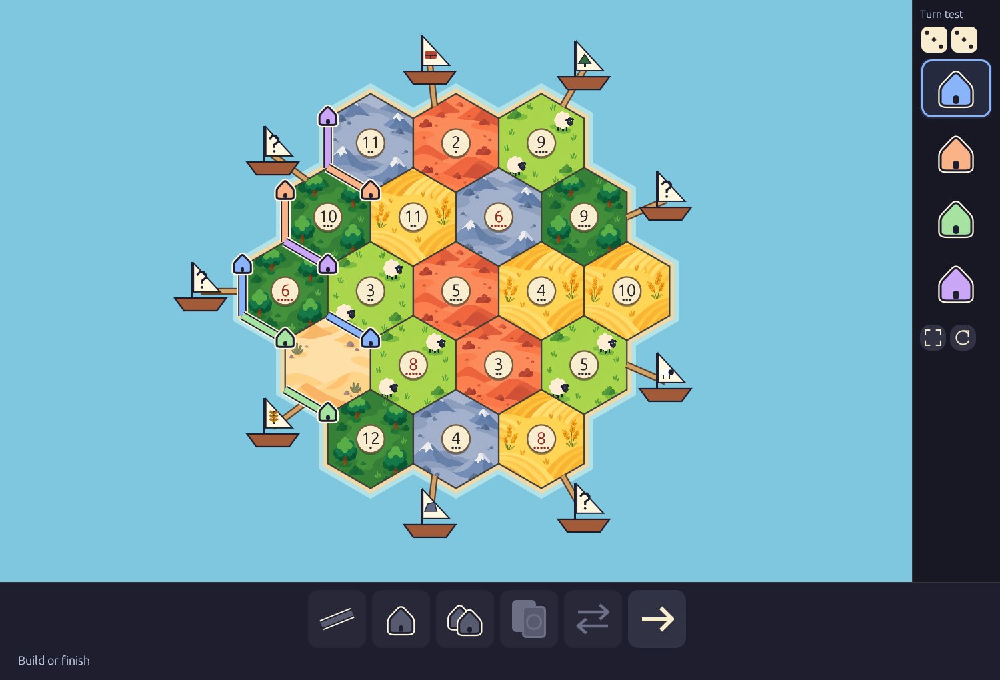
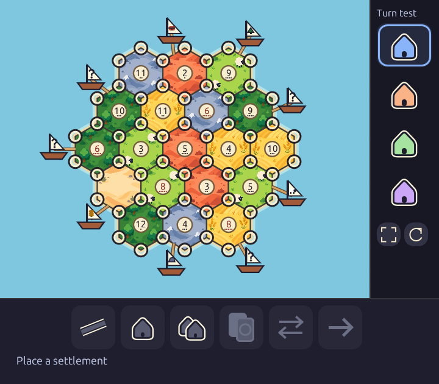
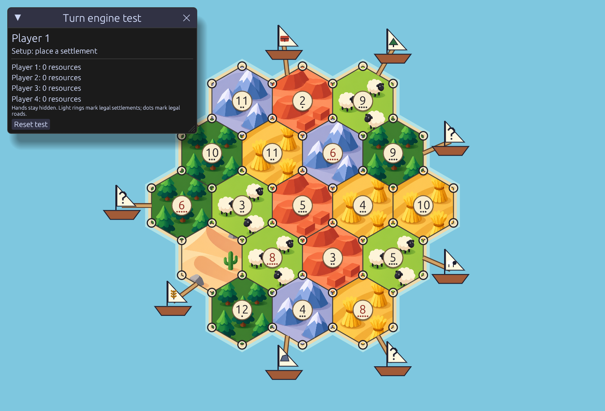
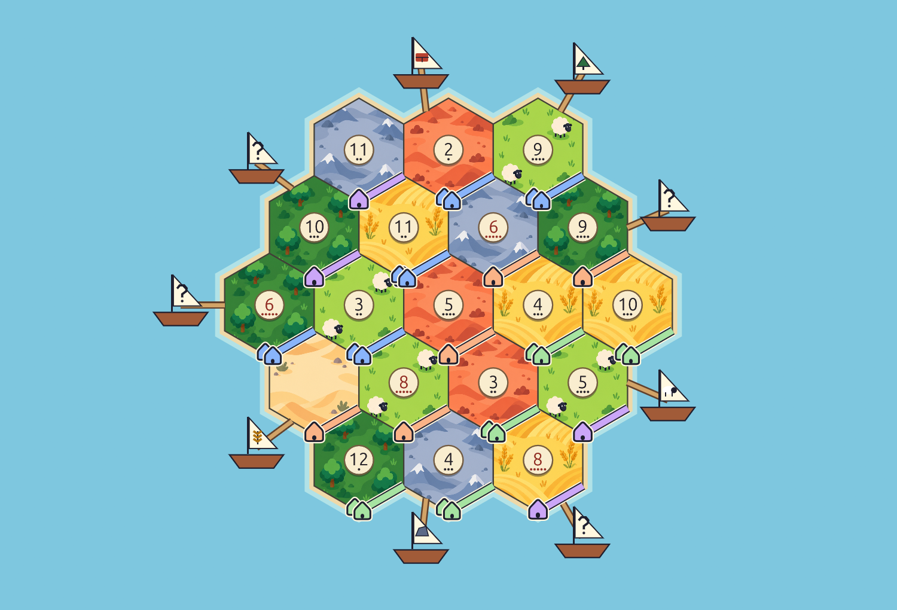
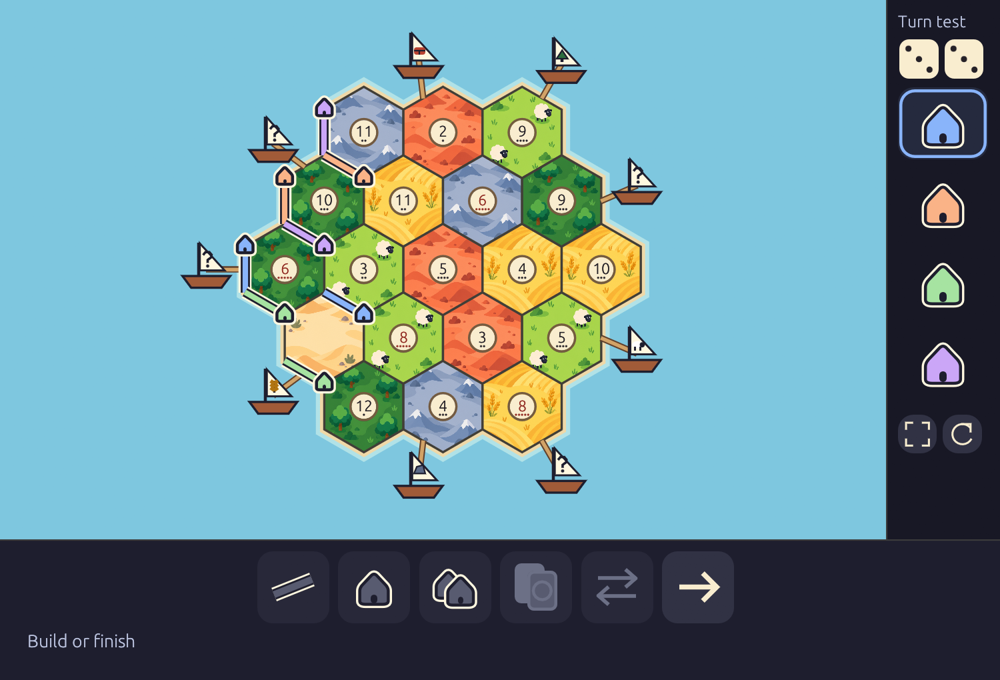

# The Colonizers of Resourceville



Build a foothold on a resource-rich island, trade with your neighbors, and turn a small settlement into a thriving network of towns and trade routes. **The Colonizers of Resourceville** is a native Rust strategy game in development for Windows, with original branding and a focus on readable boards, meaningful choices, and games you can play with friends or bots.

The planned experience starts with gathering resources, negotiating trades, building roads and settlements, and competing for victory points. Later releases expand into seafaring, city development, defense, caravans, exploration, and scenario objectives. Hosts will be able to choose maps, rules, player counts, and human/bot seats before each game.

Offline solo play and private online rooms come first. The roadmap then grows from 2–4 to 2–8 players, followed by public casual play and ranked queues. The desktop client and authoritative game server will both use Rust; online identity and persistence will use Supabase.

**Current status:** M03 is approved and merged through [PR #10](https://github.com/Codings-Biggest-Fan/colonizers-of-resourceville/pull/10). M04 ([merged PR #11](https://github.com/Codings-Biggest-Fan/colonizers-of-resourceville/pull/11)) is a user-approved beta testing baseline awaiting refinement with deterministic setup, production and ordinary building turns, plus flat port graphics and contrasting pieces. Use the play icon in the graphic action dock to start the [turn-engine test](docs/base-turn-engine.md); tooltips name each control. Dice outcomes are supplied for testing; complete games, bots and saves arrive later. The M04 branch/nightly also contains the requested 2026-10-16 visual refinement; beta retains its approved earlier graphics. No release has been published.
[Documentation wiki](https://github.com/Codings-Biggest-Fan/colonizers-of-resourceville/wiki) · [Game Instructions](https://github.com/Codings-Biggest-Fan/colonizers-of-resourceville/wiki/Game-Instructions) · [Releases](https://github.com/Codings-Biggest-Fan/colonizers-of-resourceville/releases)

## Roadmap

| Milestones | What they deliver | Status |
| --- | --- | --- |
| 0 | Project setup, plans, wiki, and approval workflow | Merged; no release recorded |
| 1 | Native Rust foundation | Complete |
| 2 | Rules/configuration contracts | Complete |
| 3 | Board and preview | Complete |
| 4–6 | Base turns, complete rules, bots, and offline save/resume | M04 Verifying; M05–M06 Planned |
| 7–10 | Online identity, private rooms, reliable multiplayer, and pregame options | Planned |
| 11–14 | Citadels & Sentinels, Open Seas, combined scenarios, and up to eight players | Planned |
| 15–17 | Caravans & Raiders, Voyagers & Corsairs, map tools, and supported combinations | Planned |
| 18–20 | Public casual games, ranked play, and release verification | Planned |
| 21 | Product website and final wiki/docs | Planned |

Follow the [current roadmap](ROADMAP.md) for individual releases, acceptance gates, and progress. Each milestone has a plan, reports, and screenshot evidence. Implementation PRs target beta for explicit approval; polish uses the same milestone branch. Releases begin at M06 after approved stable promotion.

## Screenshots

These are real M04 native wgpu frames from synthetic engine test scenarios; the contrast fixture is explicitly a renderer test, not a legal game. Earlier screenshots retain their own milestone identity.

| Turn-engine test | Compact test |
| :---: | :---: |
|  |  |
| Earlier setup targets, before terrain refinement<br> | Contrast fixture<br> |
| Scaling stress<br> | [Capture metadata and full M04 archive](photos/milestone-04/index.md) |

[M03 archive and before evidence](photos/milestone-03/index.md) · [M01 evidence](photos/milestone-01/index.md) · [M00 documentation previews](photos/milestone-00/index.md)

## Building and checking the project

Install the pinned Rust/MSVC prerequisites, then use the current development branch:

```powershell
git clone https://github.com/Codings-Biggest-Fan/colonizers-of-resourceville.git
Set-Location colonizers-of-resourceville
git switch nightly
pwsh -NoProfile -File ./scripts/bootstrap.ps1
pwsh -NoProfile -File ./scripts/check.ps1 -Release
pwsh -NoProfile -File ./scripts/test.ps1
pwsh -NoProfile -File ./scripts/dev.ps1
```

The [Building guide](docs/building.md) covers prerequisites, native launch, server liveness, captures, packaging, and troubleshooting. GitHub builds cover Windows, Linux, and macOS on x86-64 and ARM64; nonlocal builds do not prove interactive runtime behavior.

### Development channels

- **nightly:** latest pushed development work, possibly unfinished.
- **beta:** latest user-approved implementation before polish.
- **stable:** approved implementation and approved polish; default branch.
- **main:** compatibility mirror of polished stable.

See the [contribution and release workflow](docs/github-workflow.md) and [agent instructions](AGENTS.md) before making changes. The project license has not been selected; asset sources are recorded in [attribution](assets/ATTRIBUTION.md).
